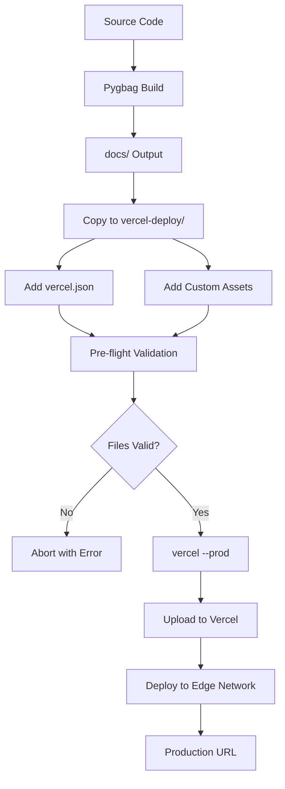
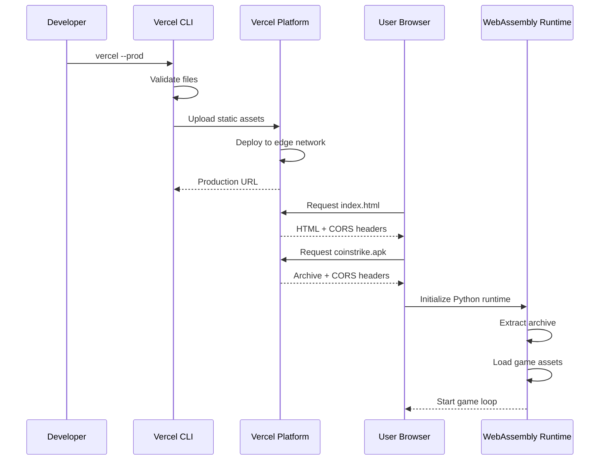

# Design Document: Vercel Deployment for CoinStrike

## Overview

This design specifies the deployment architecture for publishing the CoinStrike web version to Vercel using the Vercel CLI. The system handles Pygbag-generated WebAssembly builds, configures CORS headers for SharedArrayBuffer support, optimizes game performance for browser execution, and provides a seamless loading experience.

### Key Design Goals

1. **Single-Command Deployment**: Deploy with `vercel --prod` from the prepared directory
2. **WebAssembly Compatibility**: Configure proper CORS headers for SharedArrayBuffer and WebAssembly execution
3. **Performance Optimization**: Limit resource usage (enemies, particles, FPS) for stable web execution
4. **Custom Loading Experience**: Replace default Pygbag loading screen with game-branded assets
5. **Deployment Validation**: Pre-flight checks to catch missing files before upload

### Technology Stack

- **Hosting Platform**: Vercel (static site hosting with edge network)
- **Build Tool**: Pygbag 0.9.3 (Pygame → WebAssembly compiler)
- **Deployment Tool**: Vercel CLI
- **Configuration**: vercel.json (static builder, CORS headers, routing)
- **Web Runtime**: Python 3.12 compiled to WebAssembly via Emscripten

## Architecture

### Deployment Workflow



### Directory Structure

```
vercel-deploy/               # Deployment root
├── index.html              # Pygbag-generated entry point (modified)
├── coinstrike.apk          # Game assets archive (~248MB)
├── coinstrike.tar.gz       # Alternative archive format (~248MB)
├── favicon.png             # Browser tab icon
├── loading-page.jpg        # Custom loading background
├── vercel.json             # Vercel configuration
├── README.md               # Deployment documentation
└── .vercel/
    └── project.json        # Project linking metadata
```

### Component Interaction



## Components and Interfaces

### 1. Build Integration Component

**Purpose**: Generate web-compatible game build using Pygbag

**Interface**:

```bash
# Build command
pygbag --build --disable-sound-format-error .

# Output location
build/web/
├── index.html
├── coinstrike.apk
├── coinstrike.tar.gz
└── favicon.png
```

**Responsibilities**:

- Compile Python source to WebAssembly
- Bundle all game assets into .apk and .tar.gz archives
- Generate index.html with Pygame-web loader
- Handle audio format compatibility (MP3 → silent for web)

**Configuration**:

- `--disable-sound-format-error`: Skip MP3 validation (browser incompatibility)
- Target Python version: 3.12
- Screen resolution: 1280x720 (configured in index.html)
- CDN: `https://pygame-web.github.io/cdn/0.9.3/`

### 2. File Preparation Component

**Purpose**: Copy build artifacts to deployment directory and add custom assets

**Interface**:

```bash
# Copy operation
cp -r docs/* vercel-deploy/

# Required files in vercel-deploy/
- index.html (from Pygbag)
- coinstrike.apk (from Pygbag)
- coinstrike.tar.gz (from Pygbag)
- favicon.png (from Pygbag)
- vercel.json (custom configuration)
- loading-page.jpg (custom asset)
- README.md (documentation)
```

**Responsibilities**:

- Copy Pygbag output from docs/ to vercel-deploy/
- Preserve custom assets (loading-page.jpg, vercel.json)
- Maintain .vercel/ directory for project linking
- Ensure file permissions are preserved

**File Size Expectations**:

- coinstrike.apk: ~248MB (all game assets bundled)
- coinstrike.tar.gz: ~248MB (alternative format for non-itch.io hosts)
- index.html: ~20KB (loader script)
- Total deployment size: ~496MB

### 3. Vercel Configuration Component

**Purpose**: Define static hosting rules, CORS headers, and routing

**Interface** (vercel.json):

```json
{
  "version": 2,
  "builds": [
    {
      "src": "**",
      "use": "@vercel/static"
    }
  ],
  "routes": [
    {
      "src": "/(.*)",
      "dest": "/$1"
    }
  ],
  "headers": [
    {
      "source": "/(.*)",
      "headers": [
        {
          "key": "Cross-Origin-Embedder-Policy",
          "value": "require-corp"
        },
        {
          "key": "Cross-Origin-Opener-Policy",
          "value": "same-origin"
        }
      ]
    }
  ]
}
```

**Responsibilities**:

- Configure @vercel/static builder for all files
- Set CORS headers required for SharedArrayBuffer (WebAssembly threading)
- Define routing rules (passthrough for all paths)
- Specify API version (v2)

**CORS Header Requirements**:

- `Cross-Origin-Embedder-Policy: require-corp` - Enables cross-origin isolation
- `Cross-Origin-Opener-Policy: same-origin` - Prevents cross-origin window access
- Both headers required for `SharedArrayBuffer` support in modern browsers

### 4. Deployment Validation Component

**Purpose**: Pre-flight checks before upload to catch missing files

**Interface**:

```python
def validate_deployment_files(deploy_dir: str) -> tuple[bool, list[str]]:
    """
    Validate required files exist and meet size requirements.

    Returns:
        (is_valid, missing_files)
    """
    required_files = {
        "index.html": {"min_size": 1000},
        "coinstrike.apk": {"min_size": 100 * 1024 * 1024},  # 100MB
        "coinstrike.tar.gz": {"min_size": 100 * 1024 * 1024},
        "vercel.json": {"min_size": 100},
        "favicon.png": {"min_size": 100}
    }
    # Check each file exists and meets size requirement
    # Return list of missing/invalid files
```

**Responsibilities**:

- Verify index.html exists and contains Pygbag loader
- Verify archive files exist and are >100MB (not empty/corrupted)
- Verify vercel.json exists and contains valid JSON
- Verify favicon.png exists
- Abort deployment if any file is missing or invalid

**Error Messages**:

```
Deployment validation failed:
  - Missing file: coinstrike.apk
  - File too small: vercel.json (50 bytes, expected >100 bytes)
  - Invalid JSON: vercel.json (line 5: unexpected token)
```

### 5. Vercel CLI Component

**Purpose**: Execute deployment to Vercel platform

**Interface**:

```bash
# Production deployment
vercel --prod

# Output
Vercel CLI 28.x.x
🔍  Inspect: https://vercel.com/[org]/[project]/[deployment-id]
✅  Production: https://vercel-deploy-psi-lyart.vercel.app [copied]
```

**Responsibilities**:

- Authenticate with Vercel (reads ~/.vercel/auth.json)
- Upload all files in current directory
- Link to existing project (reads .vercel/project.json)
- Deploy to production domain
- Return production URL

**Authentication**:

- First-time: `vercel login` (opens browser for OAuth)
- Subsequent: Reads token from ~/.vercel/auth.json
- Project linking: Reads .vercel/project.json for project ID

**Deployment Targets**:

- Production URL: https://vercel-deploy-psi-lyart.vercel.app
- Preview URLs: https://vercel-deploy-[hash].vercel.app (for non-prod deploys)

### 6. Performance Optimization Component

**Purpose**: Limit resource usage for stable web execution

**Interface** (main.py modifications):

```python
import sys

# Platform detection
IS_WEB = sys.platform == "emscripten"

# Web-specific limits
if IS_WEB:
    WEB_FPS = 60  # Target frame rate
    WEB_MAX_ENEMIES = 5  # Max concurrent enemies
    WEB_MAX_PARTICLES = 30  # Max particle effects
else:
    WEB_FPS = 60
    WEB_MAX_ENEMIES = 999
    WEB_MAX_PARTICLES = 999

# Game loop
async def main():
    while running:
        clock.tick(WEB_FPS)
        # ... game logic ...
        await asyncio.sleep(0)  # Yield to browser event loop
```

**Responsibilities**:

- Detect web platform via `sys.platform == "emscripten"`
- Set FPS target to 60 for web (vs 60 for desktop)
- Limit max enemies to 5 (vs unlimited for desktop)
- Limit max particles to 30 (vs unlimited for desktop)
- Yield control to browser event loop every frame via `asyncio.sleep(0)`

**Performance Targets**:

- Frame rate: 60 FPS sustained
- Frame time: <16.67ms per frame
- Memory usage: <512MB (browser limit)
- No freezing for 5+ minute sessions

### 7. Custom Loading Page Component

**Purpose**: Replace default Pygbag loading screen with branded experience

**Interface** (index.html modifications):

```html
<!-- Custom loading page styles -->
<style>
  #infobox {
    background: url("loading-page.jpg") center/cover;
    width: 100%;
    height: 100%;
    display: flex;
    align-items: center;
    justify-content: center;
  }

  .progress-container {
    background: rgba(0, 0, 0, 0.7);
    padding: 20px;
    border-radius: 10px;
  }

  .progress-bar {
    width: 400px;
    height: 30px;
    border: 2px solid #00ffff;
    background: #1a0a30;
  }

  .progress-fill {
    height: 100%;
    background: linear-gradient(90deg, #00ffff, #ff00ff);
    transition: width 0.3s;
  }
</style>

<!-- Loading progress display -->
<div id="infobox">
  <div class="progress-container">
    <div class="progress-bar">
      <div class="progress-fill" id="progress-fill"></div>
    </div>
    <div class="progress-text">
      Loading <span id="progress-percent">0</span>%
    </div>
  </div>
</div>
```

**Responsibilities**:

- Display loading-page.jpg as background
- Show progress bar with percentage (0-100%)
- Update progress in real-time as assets download
- Hide loading screen when complete
- Transition directly to game menu (no click required)

**Loading Stages**:

1. **0-30%**: Downloading Python runtime (WASM)
2. **30-60%**: Downloading game archive (coinstrike.apk)
3. **60-90%**: Extracting archive and loading assets
4. **90-100%**: Initializing Pygame and game systems
5. **100%**: Transition to menu

### 8. Direct Menu Start Component

**Purpose**: Bypass "click to start" prompt for immediate gameplay

**Interface** (index.html modifications):

```javascript
// Skip user media engagement check
async function custom_site() {
  // ... existing code ...

  // REMOVED: Wait for user gesture
  // if (!platform.window.MM.UME) {
  //     while (!platform.window.MM.UME) {
  //         await asyncio.sleep(.1);
  //     }
  // }

  // Start game directly
  await shell.source(main, (callback = ui_callback));
  platform.window.infobox.style.display = "none";
}
```

**Responsibilities**:

- Remove user media engagement (UME) check
- Start game loop immediately after asset loading
- Transition directly to menu screen
- Handle audio context initialization gracefully (may require first interaction)

**Audio Handling**:

- Audio context may be blocked until first user interaction (browser policy)
- Game starts with audio muted if no gesture yet
- Audio enables automatically on first click/keypress
- No error messages or blocking prompts

## Data Models

### Deployment Configuration Model

```json
{
  "project_id": "prj_abc123",
  "org_id": "team_xyz789",
  "production_url": "https://vercel-deploy-psi-lyart.vercel.app",
  "framework": null,
  "build_command": null,
  "output_directory": null,
  "install_command": null
}
```

**Stored in**: `.vercel/project.json`

**Fields**:

- `project_id`: Vercel project identifier (links deployments to project)
- `org_id`: Organization/team identifier
- `production_url`: Canonical production domain
- `framework`: null (static site, no framework detection)
- `build_command`: null (pre-built, no build step on Vercel)
- `output_directory`: null (deploy from root)
- `install_command`: null (no dependencies to install)

### Build Metadata Model

```json
{
  "pygbag_version": "0.9.3",
  "python_version": "3.12",
  "screen_width": 1280,
  "screen_height": 720,
  "cdn_url": "https://pygame-web.github.io/cdn/0.9.3/",
  "archive_format": "apk",
  "bundle_name": "coinstrike"
}
```

**Embedded in**: index.html (JavaScript config object)

**Fields**:

- `pygbag_version`: Pygbag build tool version
- `python_version`: Python runtime version (compiled to WASM)
- `screen_width`/`screen_height`: Game canvas dimensions
- `cdn_url`: Pygame-web CDN for runtime files
- `archive_format`: "apk" for itch.io, "tar.gz" for other hosts
- `bundle_name`: Game identifier (used for /data/data/[bundle] path)

### Performance Limits Model

```python
@dataclass
class WebPerformanceLimits:
    fps: int = 60
    max_enemies: int = 5
    max_particles: int = 30
    max_projectiles: int = 20
    enemy_spawn_interval: int = 180  # frames (3 seconds)
    particle_prune_threshold: int = 30
```

**Usage**: Applied when `sys.platform == "emscripten"`

**Fields**:

- `fps`: Target frame rate (clock.tick argument)
- `max_enemies`: Maximum concurrent enemies on screen
- `max_particles`: Maximum particle effects (death, hit, etc.)
- `max_projectiles`: Maximum enemy projectiles
- `enemy_spawn_interval`: Minimum frames between enemy spawns
- `particle_prune_threshold`: Prune oldest particles when limit reached

## Error Handling

### Deployment Errors

**Missing Files**:

```
Error: Deployment validation failed
Missing required files:
  - coinstrike.apk
  - vercel.json

Please run the build process and ensure all files are copied to vercel-deploy/
```

**Invalid vercel.json**:

```
Error: Invalid vercel.json configuration
JSON parsing error at line 12: Unexpected token }

Please validate your vercel.json syntax
```

**Authentication Failure**:

```
Error: Not authenticated with Vercel
Run 'vercel login' to authenticate

Alternatively, set VERCEL_TOKEN environment variable
```

**Network Errors**:

```
Error: Deployment failed
HTTP 503: Service Unavailable

Vercel platform may be experiencing issues. Please try again later.
```

### Runtime Errors

**WebAssembly Initialization Failure**:

```
Error: Failed to initialize WebAssembly runtime
SharedArrayBuffer is not available

This browser does not support SharedArrayBuffer or CORS headers are misconfigured.
Please check:
  1. CORS headers are set in vercel.json
  2. Browser supports SharedArrayBuffer (Chrome 92+, Firefox 79+)
  3. Site is served over HTTPS
```

**Asset Loading Failure**:

```
Error: Failed to load game assets
Could not download coinstrike.apk (HTTP 404)

The game archive is missing from the deployment.
Please redeploy with all required files.
```

**Memory Exhaustion**:

```
Error: Out of memory
The game has exceeded the browser's memory limit

Try:
  1. Closing other browser tabs
  2. Using a browser with higher memory limits
  3. Reloading the page to restart the game
```

**Performance Degradation**:

```
Warning: Frame rate dropped below 30 FPS
The game may run slowly on this device

Performance tips:
  - Close other applications
  - Use a desktop browser instead of mobile
  - Reduce browser zoom level to 100%
```

### Error Recovery Strategies

1. **Deployment Validation Failure**: Abort before upload, display checklist of missing files
2. **Authentication Failure**: Prompt for `vercel login`, provide token setup instructions
3. **Network Errors**: Retry with exponential backoff (3 attempts), display status code
4. **CORS Errors**: Display browser compatibility message, link to vercel.json documentation
5. **Asset Loading Errors**: Display error overlay with reload button
6. **Memory Errors**: Display warning, offer to restart game with lower quality settings
7. **Performance Errors**: Log warning to console, continue with degraded performance

## Testing Strategy

This feature involves Infrastructure as Code (Vercel configuration) and deployment automation, which are not suitable for property-based testing. The testing strategy focuses on:

### Unit Tests

**File Validation Tests**:

```python
def test_validate_deployment_files_all_present():
    """Test validation passes when all required files exist"""
    # Create temp directory with all required files
    # Call validate_deployment_files()
    # Assert is_valid == True, missing_files == []

def test_validate_deployment_files_missing_apk():
    """Test validation fails when coinstrike.apk is missing"""
    # Create temp directory without coinstrike.apk
    # Call validate_deployment_files()
    # Assert is_valid == False, "coinstrike.apk" in missing_files

def test_validate_deployment_files_apk_too_small():
    """Test validation fails when coinstrike.apk is <100MB"""
    # Create temp directory with 1KB coinstrike.apk
    # Call validate_deployment_files()
    # Assert is_valid == False, error mentions file size

def test_validate_vercel_json_syntax():
    """Test validation catches invalid JSON in vercel.json"""
    # Create vercel.json with syntax error
    # Call validate_deployment_files()
    # Assert is_valid == False, error mentions JSON parsing
```

**Performance Limit Tests**:

```python
def test_web_platform_detection():
    """Test IS_WEB flag is set correctly"""
    # Mock sys.platform = "emscripten"
    # Import main module
    # Assert IS_WEB == True

def test_enemy_limit_enforced():
    """Test enemy manager respects WEB_MAX_ENEMIES"""
    # Set IS_WEB = True
    # Spawn 10 enemies
    # Assert len(enemy_manager.enemies) <= WEB_MAX_ENEMIES

def test_particle_limit_enforced():
    """Test particle system respects WEB_MAX_PARTICLES"""
    # Set IS_WEB = True
    # Create 50 particles
    # Assert len(particle_list) <= WEB_MAX_PARTICLES

def test_fps_target_applied():
    """Test clock.tick() uses WEB_FPS on web platform"""
    # Set IS_WEB = True
    # Run game loop for 1 second
    # Assert clock.get_fps() ≈ WEB_FPS ± 5
```

### Integration Tests

**Deployment Workflow Tests**:

```bash
# Test full deployment workflow
test_full_deployment_workflow() {
    # 1. Build with Pygbag
    pygbag --build --disable-sound-format-error .
    assert_file_exists "build/web/index.html"

    # 2. Copy to deployment directory
    cp -r docs/* vercel-deploy/
    assert_file_exists "vercel-deploy/coinstrike.apk"

    # 3. Validate files
    python validate_deployment.py
    assert_exit_code 0

    # 4. Deploy to Vercel (preview)
    cd vercel-deploy
    vercel --yes
    assert_exit_code 0
    assert_output_contains "https://"
}
```

**CORS Header Tests**:

```bash
# Test CORS headers are set correctly
test_cors_headers() {
    # Deploy to preview URL
    PREVIEW_URL=$(vercel --yes | grep -o 'https://[^ ]*')

    # Check Cross-Origin-Embedder-Policy header
    COEP=$(curl -sI "$PREVIEW_URL" | grep -i "cross-origin-embedder-policy")
    assert_equals "$COEP" "Cross-Origin-Embedder-Policy: require-corp"

    # Check Cross-Origin-Opener-Policy header
    COOP=$(curl -sI "$PREVIEW_URL" | grep -i "cross-origin-opener-policy")
    assert_equals "$COOP" "Cross-Origin-Opener-Policy: same-origin"
}
```

**Game Loading Tests**:

```javascript
// Test game loads without errors (Playwright/Puppeteer)
test("game loads and starts", async () => {
  await page.goto("https://vercel-deploy-psi-lyart.vercel.app");

  // Wait for loading screen
  await page.waitForSelector("#infobox");

  // Wait for game to start (loading screen disappears)
  await page.waitForSelector("#infobox", { state: "hidden", timeout: 60000 });

  // Check canvas is visible
  const canvas = await page.$("#canvas");
  expect(canvas).toBeTruthy();

  // Check no console errors
  const errors = await page.evaluate(() => window.errors || []);
  expect(errors).toHaveLength(0);
});
```

### Manual Testing Checklist

**Pre-Deployment**:

- [ ] Run `pygbag --build` and verify build succeeds
- [ ] Check docs/ contains index.html, .apk, .tar.gz
- [ ] Copy files to vercel-deploy/ and verify all present
- [ ] Run validation script and verify no errors
- [ ] Check vercel.json syntax is valid

**Deployment**:

- [ ] Run `vercel --prod` from vercel-deploy/
- [ ] Verify deployment succeeds and returns production URL
- [ ] Check deployment time is <5 minutes
- [ ] Verify no authentication errors

**Post-Deployment**:

- [ ] Visit production URL in Chrome
- [ ] Verify loading screen appears with custom background
- [ ] Verify progress bar updates from 0-100%
- [ ] Verify game starts without "click to start" prompt
- [ ] Verify game menu appears after loading
- [ ] Check browser console for CORS errors (should be none)
- [ ] Test gameplay for 5 minutes without freezing
- [ ] Verify FPS stays above 50
- [ ] Test on Firefox and Edge browsers
- [ ] Test on mobile browser (iOS Safari, Android Chrome)

**Performance Testing**:

- [ ] Monitor FPS counter (should stay near 60)
- [ ] Count enemies on screen (should not exceed 5)
- [ ] Trigger particle effects (should not exceed 30)
- [ ] Play for 10 minutes continuously
- [ ] Check memory usage in browser DevTools (<512MB)
- [ ] Verify no memory leaks (memory stable over time)

### Snapshot Tests

**vercel.json Configuration**:

```python
def test_vercel_json_snapshot():
    """Test vercel.json matches expected configuration"""
    with open('vercel-deploy/vercel.json') as f:
        config = json.load(f)

    expected = {
        "version": 2,
        "builds": [{"src": "**", "use": "@vercel/static"}],
        "routes": [{"src": "/(.*)", "dest": "/$1"}],
        "headers": [
            {
                "source": "/(.*)",
                "headers": [
                    {"key": "Cross-Origin-Embedder-Policy", "value": "require-corp"},
                    {"key": "Cross-Origin-Opener-Policy", "value": "same-origin"}
                ]
            }
        ]
    }

    assert config == expected
```

**index.html Structure**:

```python
def test_index_html_contains_required_elements():
    """Test index.html has all required elements for game loading"""
    with open('vercel-deploy/index.html') as f:
        html = f.read()

    # Check Pygbag loader script
    assert 'pythons.js' in html
    assert 'data-python="python3.12"' in html

    # Check canvas elements
    assert '<canvas class="emscripten" id="canvas"' in html

    # Check loading elements
    assert '<div id="infobox"' in html
    assert '<progress' in html

    # Check custom site function
    assert 'async def custom_site():' in html
```

## Summary

This design provides a complete deployment architecture for publishing CoinStrike to Vercel. The system handles:

1. **Build Integration**: Pygbag generates WebAssembly build with all assets bundled
2. **File Preparation**: Copy build artifacts and add custom assets to deployment directory
3. **Configuration**: vercel.json defines static hosting, CORS headers, and routing
4. **Validation**: Pre-flight checks catch missing files before upload
5. **Deployment**: Vercel CLI uploads and deploys to production URL
6. **Performance**: Platform detection limits resources for stable web execution
7. **Loading Experience**: Custom loading page with progress bar and direct menu start
8. **Error Handling**: Comprehensive error messages and recovery strategies

The deployment workflow is simple (`vercel --prod`), the configuration is minimal (single vercel.json file), and the result is a production-ready web game accessible at https://vercel-deploy-psi-lyart.vercel.app.

**Next Steps**: Proceed to task creation phase to break down implementation into concrete development tasks.
